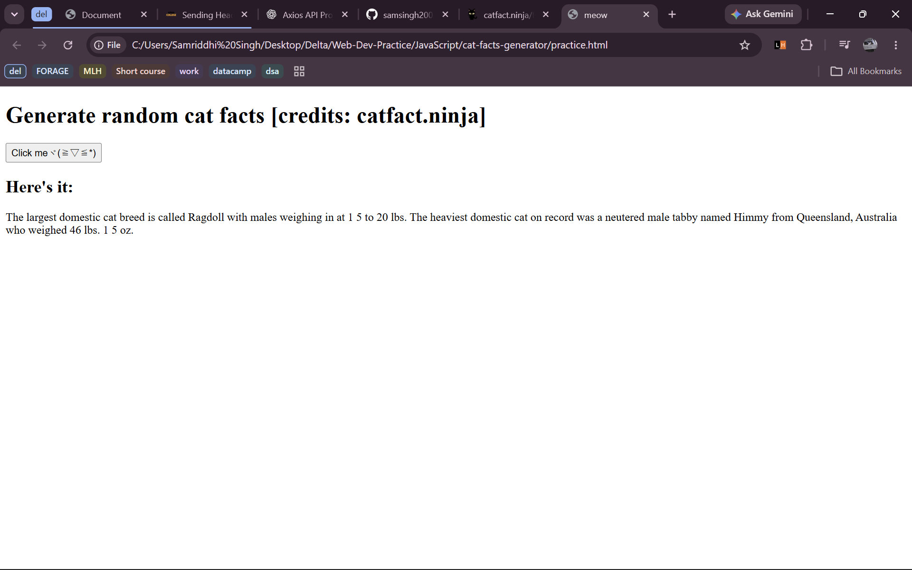

# Cat Facts Generator 🐱

A beginner JavaScript project that fetches random cat facts from the [Cat Facts API](https://catfact.ninja/) using Axios and displays them on the webpage when the button is clicked.

### Tech Stack
- HTML
- JavaScript
- Axios
- Cat Facts API

### Concepts Learned
- API requests using `axios.get()`
- Async/await
- Promises and error handling
- DOM manipulation and event listeners

### Screenshot

